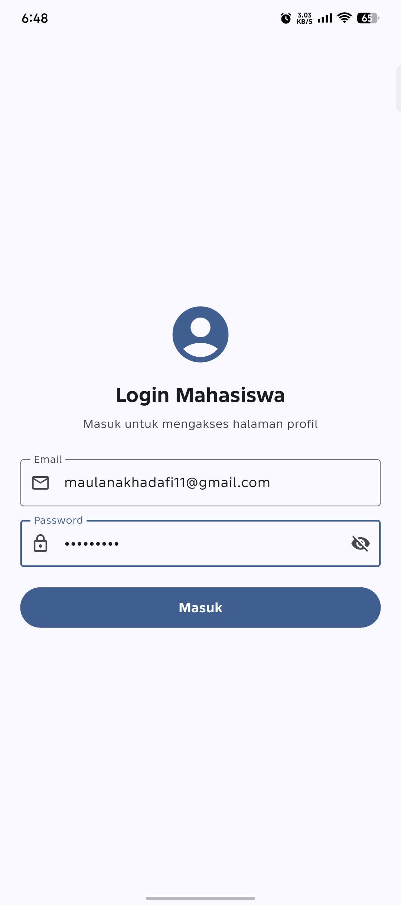
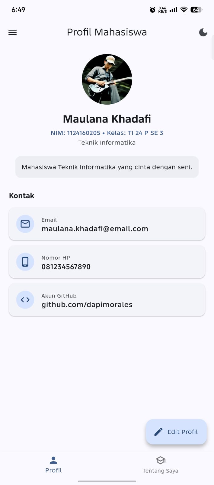
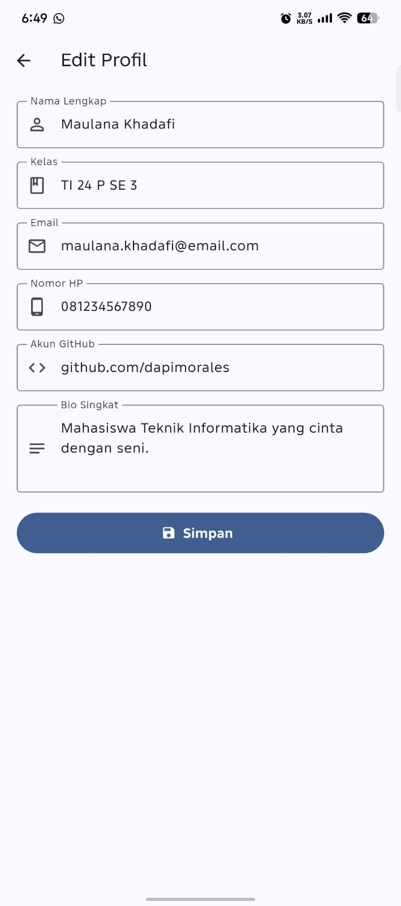

# UTS Pemrograman Mobile Lanjutan

## Identitas Mahasiswa
- **Nama:** Maulana Khadafi
- **NIM:** 1124160205
- **Kelas:** TI-24-A
- **Program Studi:** Teknik Informatika - Institut Teknologi & Bisnis Bina Sarana Global

## Link Video Presentasi YouTube
- [Tonton Video Presentasi di YouTube](https://youtu.be/LINK_VIDEO_KAMU)

## Daftar Fitur (`soal2-profil-app`)
1. **Halaman Login:** StatefulWidget dengan validasi form, indikator loading asynchronous, dan `pushReplacementNamed`.
2. **Halaman Profil:** Foto `CircleAvatar` dari `assets/images/`, biodata lengkap, kartu kontak (`Card` + `ListTile`), `Drawer`, `BottomNavigationBar`, dan `FloatingActionButton`.
3. **Halaman Edit Profil:** Form praisi dengan `TextEditingController`, validasi nama, email, serta nomor HP (10–13 digit angka), dan pengembalian data via `Navigator.pop(context, dataBaru)`.
4. **Halaman Tentang Saya:** Daftar keahlian/hobi dan riwayat pendidikan dengan `ListView`.
5. **Tema & Identitas Android:** Pergantian mode gelap langsung di dalam aplikasi dan label aplikasi Android `Profil Miles`.

## Screenshot Aplikasi
| Login | Profil | Edit Profil |
| :---: | :---: | :---: |
|  |  |  |

## Cara Menjalankan Proyek
```bash
cd soal2-profil-app
flutter pub get
flutter run
